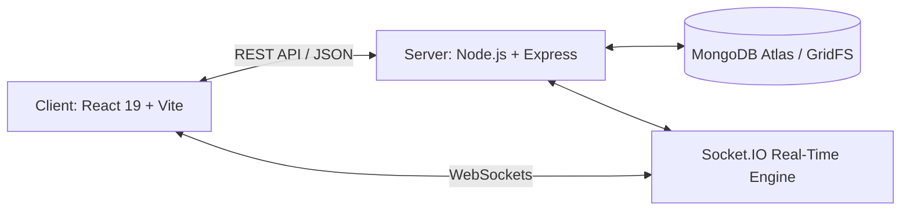

# ServeEase — Smart Local Service Booking Platform

> **Academic Mini-Project** | Full-Stack Web Development  
> **Architecture:** MERN Stack (MongoDB, Express.js, React.js, Node.js) with Socket.IO & Leaflet OpenStreetMap  

---

## 📌 Project Overview

**ServeEase** is a full-stack hyper-local service booking and management platform designed to connect verified neighborhood technicians (electricians, plumbers, carpenters, cleaning specialists, mechanics) with household customers across urban and semi-urban Indian cities (Sangli, Mumbai, Pune, Nagpur, Chhatrapati Sambhajinagar).

The platform addresses core reliability issues in local on-demand service marketplaces—such as unverified technicians, billing disputes, and no-shows—by enforcing **document-backed provider verification**, **live GPS doorstep pinpointing**, and a **cryptographic 6-digit on-site arrival OTP**.

---

## 🚀 Key Features & Technology Stack

| Feature Module | Functionality & Academic Scope | Underlying Technologies |
| :--- | :--- | :--- |
| **Authentication & RBAC** | Role-Based Access Control distinguishing Customers, Providers, and Admins. Email verification, password recovery with expiring OTPs, and Remember-Me cookie sessions. | JWT (JSON Web Tokens), `bcrypt` (12 salt rounds), Nodemailer, HTTP-only secure cookies |
| **Provider Verification & GridFS** | Technicians must upload government IDs and trade certificates. Accounts remain pending until reviewed and approved by an Administrator. | MongoDB GridFS (chunked binary storage), Mongoose schemas, Sharp image processing |
| **Service Catalog & Geolocation** | 9 service categories across 5 cities. Search, category filtering, and live GPS doorstep pinpointing with Leaflet maps. Supports auto-extracting coordinates from Google Maps URLs. | React 19, Leaflet, OpenStreetMap tiles, HTML5 Geolocation API, RegEx coordinate parsing |
| **Booking Lifecycle & Arrival OTP** | Strict state machine (`pending` → `accepted` → `arrival_verified` → `in_progress` → `completed` / `cancelled`). On-site technician arrival requires entering a unique 6-digit OTP visible only to the customer. | MongoDB Transactions, SHA-256 OTP hashing, State machine validation |
| **Real-Time Messaging & Alerts** | In-app messaging for active bookings, read receipts, and instantaneous notification broadcasts upon booking status transitions and administrative cancellations. | Socket.IO (WebSockets), Persistent MongoDB Notifications collection |
| **Verified Reviews & Moderation** | Anti-gaming review system restricted exclusively to customers with completed bookings. Admin review inspection and moderation. | MongoDB aggregation pipelines, Bayesian weighted provider ratings |
| **Admin Oversight & Analytics** | Platform dashboard tracking active bookings, revenue, category distribution, user suspension/reactivation, and non-destructive cancellation with dual participant alerts. | MongoDB aggregation framework, Audit logging |

---

## 🛠️ Technology Stack



- **Frontend:** React 19, Vite, React Router v7, Lucide Icons, Leaflet OpenStreetMap
- **Backend:** Node.js (ESM), Express.js, Socket.IO, Mongoose ODM, MongoDB GridFS
- **Security:** Helmet, CORS allowlisting, rate-limiting, bcrypt hashing, JWT cookie sessions
- **Testing:** Node.js Native Test Runner, Supertest, `mongodb-memory-server`, Vitest, JSDOM, Playwright

---

## 📂 Project Structure

```text
ServeEase/
├── client/                     # Frontend Single Page Application
│   ├── src/
│   │   ├── components/         # Reusable UI (booking, provider cards, maps)
│   │   ├── context/            # AuthContext, ThemeContext
│   │   ├── pages/              # Customer, Provider, Admin pages & Discovery
│   │   ├── services/           # Axios/Fetch API client and Socket.IO client
│   │   └── test/               # Vitest component & integration test suites
│   └── vite.config.js          # Vite build & Vitest test runner configuration
│
├── server/                     # Backend REST API & WebSocket Server
│   ├── src/
│   │   ├── config/             # Database, cities, and canonical service categories
│   │   ├── controllers/        # Auth, User, Provider, Booking, Admin controllers
│   │   ├── models/             # Mongoose schemas (User, Booking, Review, Notification)
│   │   ├── routes/             # Express API routing endpoints
│   │   ├── socket/             # Socket.IO room handling and real-time events
│   │   └── scripts/            # Database seeders (demo provider dataset)
│   └── test/                   # 18 automated integration test suites (97 tests)
│
└── README.md                   # Project documentation
```

---

## ⚡ Getting Started (Local Development)

### 1. Prerequisites
- **Node.js:** v18.0.0 or higher
- **MongoDB:** Local MongoDB instance or MongoDB Atlas connection URI

### 2. Backend Setup
```bash
cd server
npm install

# Configure environment variables in server/.env
# PORT=5001
# MONGODB_URI=mongodb://localhost:27017/serveease
# JWT_SECRET=your_secret_key_minimum_32_characters

# Seed demonstration providers across Sangli, Pune, Mumbai, etc.
npm run seed:demo

# Start backend server
npm run dev
```

### 3. Frontend Setup
```bash
cd ../client
npm install

# Start Vite development server
npm run dev
```
Open **`http://localhost:5173`** in your browser.

---

## 🧪 Automated Testing Suite

The project includes automated test coverage across both frontend and backend layers:

```bash
# 1. Run all 18 backend integration test suites (97 tests)
cd server
npm test

# 2. Run all 10 frontend Vitest component suites (44 tests)
cd ../client
npm test
```

---

## 🎓 Academic Submission Details

- **Project Title:** ServeEase — Smart Local Service Booking Platform
- **Course:** Academic Mini-Project / Capstone
- **Primary Domain:** Web Technologies, Distributed Systems & Database Management
- **Repository:** [https://github.com/Yashuke03/ServeEase_F](https://github.com/Yashuke03/ServeEase_F)
