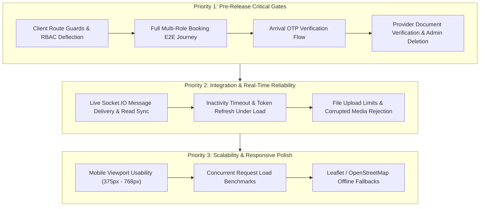

# ServeEase — Complete Project Discovery & Testing Strategy Assessment

**Document Version:** 1.0.0  
**Target Release:** Public Production Release  
**Assessment Date:** November 2026  
**System Status:** 80 / 80 Server Integration Tests Passing | Client Production Build Clean

---

## 1. Executive Summary & System Architecture

ServeEase is a modern on-demand local services platform connecting homeowners and businesses with verified local service professionals (electricians, plumbers, home cleaning, carpenters, appliance mechanics). The application implements a decoupled client-server architecture with hybrid authentication, real-time messaging, map-based service discovery, cryptographic arrival verification, and an administrative moderation suite.

```
                              ┌────────────────────────────────────────┐
                              │            Client (React 19)           │
                              │  Vite + React Router v7 + Tailwind/CSS │
                              └───────────────────┬────────────────────┘
                                                  │
                                   HTTP / REST    │    WebSocket (WSS)
                             Credentials: include │    Handshake JWT
                                                  ▼
                              ┌────────────────────────────────────────┐
                              │         Backend (Node.js/Express)      │
                              │      Modular MVC + Socket.IO Server    │
                              └───────┬──────────────┬───────────────┬─┘
                                      │              │               │
                                      ▼              ▼               ▼
 ┌──────────────────────────────────────┐  ┌───────────────────┐  ┌─────────────────────────┐
 │            MongoDB Atlas             │  │   Firebase Auth   │  │    Nodemailer (SMTP)    │
 │ Mongoose Schemas + GridFS File Store │  │ Admin SDK + OAuth │  │ 6-Digit OTP Email Engine│
 └──────────────────────────────────────┘  └───────────────────┘  └─────────────────────────┘
```

### Technology Stack & Dependency Summary

| Domain | Technologies & Libraries | Version | Purpose |
| :--- | :--- | :--- | :--- |
| **Frontend Framework** | React / React-DOM | `^19.2.8` | Declarative UI, Concurrent rendering, Context hooks |
| **Frontend Tooling** | Vite, Oxlint | `^8.3.0` / `^1.81.0` | Sub-second HMR, optimized production asset bundling, fast linting |
| **Client Routing** | React Router DOM | `^7.18.4` | Role-guarded client SPA navigation, layout shells |
| **Geospatial & Maps** | Leaflet | `^1.9.4` | OpenStreetMap coordinate rendering, draggable location pins |
| **Backend Runtime** | Node.js (ES Modules) | `>= 20` | Asynchronous I/O runtime |
| **Web Server Framework**| Express | `^4.21.2` | RESTful routing, middleware pipelines |
| **Database & ODM** | MongoDB Atlas, Mongoose | `^9.11.1` | Document storage, schema enforcement, compound indexing |
| **Binary File Storage** | MongoDB GridFS | Built-in | Secure chunked storage for trade licenses and avatars |
| **Image Processing** | Sharp | `^0.35.5` | Smart attention/saliency avatar face-centering and compression |
| **Real-time WebSockets**| Socket.IO / Client | `^4.8.4` | Bidirectional chat, instant notification alerts, typing states |
| **Authentication** | JWT (`jsonwebtoken`), `bcryptjs`, Firebase Admin SDK | `^9.0.3` / `^3.0.3` / `^14.5.0` | Dual-layered auth: Google OAuth & Firebase Sync + native bcrypt JWTs |
| **Security & Limits** | `express-rate-limit`, `cookie-parser`, `cors` | `^8.7.1` / `^1.4.7` / `^2.8.5` | Tiered route rate limiting, HttpOnly cookies, origin validation |
| **Email Service** | Nodemailer | `^10.1.1` | SMTP transport for 6-digit OTP codes and notifications |

---

## 2. Complete Feature Inventory by User Role

### A. Customer Features

| Feature | User Journey & Invariants | Frontend Component | Backend Route & Controller | Models Involved |
| :--- | :--- | :--- | :--- | :--- |
| **Registration & Verification** | User submits registration form $\to$ record stored in `PendingRegistration` (TTL 10m) $\to$ 6-digit OTP emailed $\to$ user enters OTP $\to$ account materialized in `User` collection. | `Register.jsx`<br>`VerifyEmail.jsx` | `POST /api/auth/register`<br>`POST /api/auth/verify-email-otp`<br>`POST /api/auth/resend-verification-otp`<br>([authController.js](file:///home/ash/Projects/ServeEase/server/src/controllers/authController.js)) | `PendingRegistration`<br>`User` |
| **Login & Password Recovery** | Email/Password or Google login. 15-min idle timeout. Forgot password dispatches 6-digit OTP, verifies to short-lived `resetToken`, resets password. | `Login.jsx`<br>`ForgotPassword.jsx`<br>`VerifyOtp.jsx`<br>`ResetPassword.jsx` | `POST /api/auth/login`<br>`POST /api/auth/firebase-login`<br>`POST /api/auth/forgot-password`<br>`POST /api/auth/verify-otp`<br>`POST /api/auth/reset-password`<br>([authController.js](file:///home/ash/Projects/ServeEase/server/src/controllers/authController.js)) | `User` |
| **Service Discovery & Map** | Browse categories, filter providers by verified city (`sangli`, `mumbai`, `pune`, `nagpur`, `chhatrapati-sambhajinagar`), inspect provider details, interactive Leaflet map view. | `Services.jsx`<br>`ProviderDetail.jsx`<br>`CustomerMap.jsx`<br>`ServiceMap.jsx` | `GET /api/providers`<br>`GET /api/providers/:id`<br>`GET /api/providers/cities`<br>`GET /api/providers/categories`<br>([providerController.js](file:///home/ash/Projects/ServeEase/server/src/controllers/providerController.js)) | `User` (provider role) |
| **Booking Creation & Lifecycle** | Customer books specific service and date $\to$ created in `pending` status. Customer can update delivery address and GPS coordinates, or cancel before acceptance. | `BookingModal.jsx`<br>`CustomerBookings.jsx`<br>`BookingMapModal.jsx` | `POST /api/bookings`<br>`GET /api/bookings/my`<br>`PATCH /api/bookings/:id/cancel`<br>`PATCH /api/bookings/:id/location`<br>([bookingController.js](file:///home/ash/Projects/ServeEase/server/src/controllers/bookingController.js)) | `Booking`<br>`Notification` |
| **Booking Arrival OTP Display** | Once booking is accepted by provider, a 6-digit arrival code is displayed to the customer to share with the technician strictly upon physical arrival. | `CustomerBookings.jsx` (`arrival-otp-card-${id}`) | `GET /api/bookings/:id/arrival-otp`<br>([bookingController.js](file:///home/ash/Projects/ServeEase/server/src/controllers/bookingController.js)) | `Booking` |
| **Real-time Messaging** | Direct messaging with assigned technician. Permitted only when booking is in `accepted` or `in_progress` status. Blocked when pending, rejected, or completed. | `CustomerMessages.jsx`<br>`ChatInterface.jsx`<br>`BookingChatModal.jsx` | `GET /api/conversations`<br>`POST /api/conversations`<br>`GET /api/conversations/:id/messages`<br>`POST /api/conversations/:id/messages`<br>*Socket.IO*: `join_conversation`, `send_message`, `mark_read` | `Conversation`<br>`Message`<br>`Notification` |
| **Notification Center** | Real-time and persistent alerts for booking status changes (accepted, arrived, completed, cancelled). Fast unread counter. | `CustomerNotifications.jsx`<br>`Navbar.jsx` | `GET /api/notifications`<br>`GET /api/notifications/unread-count`<br>`PATCH /api/notifications/:id/read`<br>`PATCH /api/notifications/read-all`<br>([notificationController.js](file:///home/ash/Projects/ServeEase/server/src/controllers/notificationController.js)) | `Notification` |
| **Verified Reviews & Ratings** | Customer can submit 1 to 5 star review and comment strictly after booking is `completed`. Enforces 1 review per booking. Recalculates provider's average rating. | `CustomerBookings.jsx`<br>`ProviderDetail.jsx` | `POST /api/reviews`<br>`GET /api/reviews/my`<br>`GET /api/reviews/provider/:providerId`<br>`POST /api/reviews/:id/report`<br>([reviewController.js](file:///home/ash/Projects/ServeEase/server/src/controllers/reviewController.js)) | `Review`<br>`Booking`<br>`User` |
| **Profile & Avatar Management** | Update personal details (name, phone, address). Upload avatar with Sharp attention-centered face detection and GridFS streaming storage. | `CustomerProfile.jsx`<br>`AvatarUpload.jsx` | `GET /api/users/profile`<br>`PATCH /api/users/profile`<br>`POST /api/users/profile/avatar`<br>`DELETE /api/users/profile/avatar`<br>`GET /api/users/avatar/:fileId`<br>([userController.js](file:///home/ash/Projects/ServeEase/server/src/controllers/userController.js)) | `User`<br>GridFS (`avatars`) |

---

### B. Service Provider Features

| Feature | User Journey & Invariants | Frontend Component | Backend Route & Controller | Models Involved |
| :--- | :--- | :--- | :--- | :--- |
| **Registration & Onboarding** | Provider registers with trade details (category, experience, city). Pending OTP verification. | `Register.jsx`<br>`VerifyEmail.jsx` | `POST /api/auth/register`<br>`POST /api/auth/verify-email-otp`<br>([authController.js](file:///home/ash/Projects/ServeEase/server/src/controllers/authController.js)) | `PendingRegistration`<br>`User` |
| **Business Dashboard** | Summary of active bookings, incoming requests, availability toggle, profile completion score, ratings summary. | `ProviderDashboard.jsx` | `GET /api/providers/profile`<br>`GET /api/bookings/provider`<br>`GET /api/reviews/provider/:id/stats`<br>([providerController.js](file:///home/ash/Projects/ServeEase/server/src/controllers/providerController.js)) | `User`<br>`Booking`<br>`Review` |
| **My Services Catalog** | Add, edit, and delete custom service offerings within authorized provider category. Sets starting price and hourly rate. | `ProviderMyServices.jsx` | `GET /api/providers/my-services`<br>`POST /api/providers/my-services`<br>`DELETE /api/providers/my-services/:serviceName`<br>([providerController.js](file:///home/ash/Projects/ServeEase/server/src/controllers/providerController.js)) | `User` (`providerDetails.servicesOffered`) |
| **Document Upload & Storage** | Upload ID proofs, trade licenses, address proofs (PDF, JPEG, PNG $\le 5\text{MB}$) to GridFS for admin verification. | `ProviderProfile.jsx` | `POST /api/providers/documents`<br>`GET /api/providers/documents`<br>`GET /api/providers/documents/:id`<br>`DELETE /api/providers/documents/:id`<br>([documentController.js](file:///home/ash/Projects/ServeEase/server/src/controllers/documentController.js)) | `VerificationDocument`<br>GridFS (`verification_documents`) |
| **Booking Acceptance & Rejection** | Review customer appointment requests. Provider can accept (generating arrival OTP) or decline with optional reason. | `ProviderRequests.jsx`<br>`ProviderBookings.jsx` | `PATCH /api/bookings/:id/accept`<br>`PATCH /api/bookings/:id/reject`<br>([bookingController.js](file:///home/ash/Projects/ServeEase/server/src/controllers/bookingController.js)) | `Booking`<br>`Notification` |
| **Arrival OTP Verification** | Provider arrives at customer location, requests the 6-digit code, and submits it. Cryptographically verified; marks `arrivalOtpVerified: true` and `arrivedAt: new Date()`. | `ProviderBookings.jsx` (`arrival-verification-box-${id}`) | `POST /api/bookings/:id/verify-arrival`<br>([bookingController.js](file:///home/ash/Projects/ServeEase/server/src/controllers/bookingController.js)) | `Booking`<br>`Notification` |
| **Service Execution Lifecycle** | Progress booking status: `accepted` $\to$ `in_progress` (start work) $\to$ `completed` (finish job). Completing a job triggers customer review eligibility. | `ProviderBookings.jsx` | `PATCH /api/bookings/:id/start`<br>`PATCH /api/bookings/:id/complete`<br>([bookingController.js](file:///home/ash/Projects/ServeEase/server/src/controllers/bookingController.js)) | `Booking`<br>`Notification` |
| **Location & Route Map** | Inspect customer service coordinates on interactive map. | `ProviderMap.jsx`<br>`ServiceMap.jsx` | `GET /api/bookings/:id/location`<br>([bookingController.js](file:///home/ash/Projects/ServeEase/server/src/controllers/bookingController.js)) | `Booking` |

---

### C. Administrator Features

| Feature | User Journey & Invariants | Frontend Component | Backend Route & Controller | Models Involved |
| :--- | :--- | :--- | :--- | :--- |
| **Admin Auth & Profile** | Dedicated administrator authentication. Bootstrapped securely via CLI (`createAdmin.js`). Access to platform statistics. | `Login.jsx`<br>`AdminProfile.jsx` | `POST /api/auth/login`<br>`GET /api/users/profile`<br>`PATCH /api/users/profile`<br>([authController.js](file:///home/ash/Projects/ServeEase/server/src/controllers/authController.js)) | `User` (role: admin) |
| **Platform Analytics Engine** | Real-time platform KPI metrics (total bookings, active providers, revenue estimates, city distribution). | `AdminDashboard.jsx` (Overview tab) | `GET /api/admin/stats`<br>`GET /api/admin/analytics`<br>([adminController.js](file:///home/ash/Projects/ServeEase/server/src/controllers/adminController.js)) | `User`<br>`Booking`<br>`Review` |
| **User Moderation** | Inspect 360-degree customer and provider profiles. Suspend or reactivate accounts with persistent audit logging. | `AdminDashboard.jsx` (Users tab) | `GET /api/admin/users`<br>`GET /api/admin/users/:id`<br>`PATCH /api/admin/users/:id/status`<br>([adminController.js](file:///home/ash/Projects/ServeEase/server/src/controllers/adminController.js)) | `User`<br>`AuditLog` |
| **Permanent Account Deletion** | Strict safeguards: admin cannot delete self, cannot delete last active admin, user must be suspended first. Cleans GridFS documents while preserving booking audit history. | `AdminDashboard.jsx` (Users tab) | `DELETE /api/admin/users/:id`<br>([adminController.js](file:///home/ash/Projects/ServeEase/server/src/controllers/adminController.js)) | `User`<br>`VerificationDocument`<br>GridFS<br>`Notification`<br>`AuditLog` |
| **Provider Verification & Credentials** | View uploaded trade documents in secure modal. Approve provider or reject with reason. Guard: cannot approve provider with zero uploaded documents. | `AdminDashboard.jsx` (Providers tab) | `GET /api/admin/providers`<br>`GET /api/admin/providers/:id/documents`<br>`GET /api/admin/documents/:id`<br>`PATCH /api/admin/providers/:id/verify`<br>([adminController.js](file:///home/ash/Projects/ServeEase/server/src/controllers/adminController.js)) | `User`<br>`VerificationDocument`<br>`AuditLog`<br>`Notification` |
| **Platform Bookings Oversight** | Inspect all platform appointments across all cities, filter by status, update administrative messages, moderate bookings. | `AdminDashboard.jsx` (Bookings tab) | `GET /api/admin/bookings`<br>`PATCH /api/admin/bookings/:id/message`<br>`DELETE /api/admin/bookings/:id`<br>([adminController.js](file:///home/ash/Projects/ServeEase/server/src/controllers/adminController.js)) | `Booking`<br>`AuditLog` |
| **Review Moderation** | Inspect reported or flagged reviews. Hide inappropriate content or restore reviews. | `AdminDashboard.jsx` (Reviews tab) | `GET /api/admin/reviews`<br>`PATCH /api/admin/reviews/:id/moderate`<br>([adminController.js](file:///home/ash/Projects/ServeEase/server/src/controllers/adminController.js)) | `Review`<br>`AuditLog` |
| **System Audit Trail** | Immutable log of administrative actions (suspensions, deletions, verifications, review moderation) with admin details and timestamps. | `AdminDashboard.jsx` (Audit tab) | `GET /api/admin/audit-logs`<br>([adminController.js](file:///home/ash/Projects/ServeEase/server/src/controllers/adminController.js)) | `AuditLog` |

---

## 3. Database Architecture & Key Invariants

ServeEase relies on MongoDB with Mongoose ODM. Schemas enforce strict invariants and compound indexes:

1. **`User`**:
   - `email`: Unique, normalized lowercase.
   - `firebaseUid`: Unique, sparse index.
   - `passwordHash`: Selected false by default; bcrypt 12 salt rounds.
   - `role`: Enum `['customer', 'provider', 'admin']`.
   - `city`: Indexed canonical city key.
   - `providerDetails.verificationStatus`: Indexed (`pending`, `approved`, `rejected`).
2. **`PendingRegistration`**:
   - Holds unverified registrations. Includes TTL index on `otpExpires` (10 minutes) so expired unverified accounts are automatically pruned by MongoDB.
   - Enforces max 5 failed attempts before record deletion.
3. **`Booking`**:
   - Controlled status: `['pending', 'accepted', 'in_progress', 'rejected', 'cancelled', 'completed']`.
   - Compound indexes: `{ customer: 1, provider: 1, bookingDate: 1, bookingTime: 1, status: 1 }` prevents double-booking race conditions.
   - Compound indexes: `{ provider: 1, status: 1, createdAt: -1 }` and `{ customer: 1, status: 1, createdAt: -1 }` for sub-millisecond dashboard queries.
   - Arrival OTP: Plaintext code is never stored in DB; stores `arrivalOtpHash` (SHA-256) and `arrivalOtpSeed` (AES/HMAC derivation).
4. **`Review`**:
   - Unique index on `booking`: Guarantees exactly one review per completed appointment.
   - Only customers with matching completed bookings can submit.
5. **`Conversation` & `Message`**:
   - Exactly two participants per conversation.
   - Messages indexed by `{ conversation: 1, createdAt: 1 }`.
6. **`VerificationDocument` & GridFS**:
   - Document metadata stored in MongoDB; binary payload streamed into GridFS buckets (`verification_documents`, `avatars`).

---

## 4. Authentication, Session Lifecycle & Inactivity System

ServeEase implements a hardened hybrid authentication lifecycle:

1. **Dual Authentication Flow**:
   - **Path A**: Firebase Auth (Google Popup or Email/Password) $\to$ retrieves Firebase ID token $\to$ sends to `/api/auth/firebase-login` $\to$ verifies cryptographically with Firebase Admin SDK $\to$ synchronizes with MongoDB `User`.
   - **Path B**: Native legacy auth $\to$ bcrypt password comparison $\to$ issues ServeEase JWT.
2. **Token Architecture**:
   - **Access Token**: Short-lived (15 minutes). Sent in request headers or HttpOnly cookie.
   - **Refresh Token**: Long-lived (24 hours absolute ceiling `absExp`). Embedded `absExp` and `rememberMe` flag.
3. **Remember Me Configuration**:
   - **Remember Me = ON**: Firebase sets `browserLocalPersistence` (persisted in IndexedDB). Backend sets persistent cookies with `maxAge: 24h`.
   - **Remember Me = OFF**: Firebase sets `browserSessionPersistence` (persisted only for active session). Backend sets session cookies (omitting `maxAge`, closing immediately on browser exit).
4. **15-Minute Inactivity Auto-Logout**:
   - User activity (`mousedown`, `keydown`, `scroll`, `touchstart`, `mousemove`) throttles and resets `serveease_last_activity`.
   - If user is idle for 15 minutes:
     - Background monitor triggers `logout('Session expired. Please log in again.')`.
     - `api.js` blocks background token refresh with `isUserIdle()`.
     - Active session and cookies are cleared; user is redirected to `/login`.
   - Returning to tab after 15+ minutes triggers instant evaluation on `visibilitychange` / `focus`.
   - Unauthenticated visitors on `/login` are unaffected due to silent route suppression (`isSilentAuthRoute`).
5. **Absolute 24-Hour Session Ceiling**:
   - `/api/auth/refresh` checks `remainingSec = absExp - nowSec`.
   - If expired, rejects with HTTP 401 `SESSION_MAX_EXPIRED` and clears cookies. Token refreshes **cannot** extend the 24-hour limit indefinitely.

---

## 5. Existing Test Infrastructure & Coverage Analysis

### Current Test Execution Profile
- **Test Runner**: Node.js Native Test Runner (`node --test --test-concurrency=1`).
- **Isolation**: `mongodb-memory-server` spins up an ephemeral, isolated MongoDB instance per suite.
- **SMTP Mocking**: In-memory array interception (`sentEmails.push(mailOptions)`).
- **HTTP Engine**: `supertest` for REST API boundary testing.

### Verified Test Results (80 / 80 Passing)

```
✔ 01_health_and_env.test.js              (3 tests)   — Health probe, DB ping, catalogs
✔ 02_auth_registration_otp.test.js       (6 tests)   — Registration, pending TTL, OTP, resend cooldown
✔ 03_auth_login_and_session.test.js       (8 tests)   — Login, role verification, /me, logout
✔ 04_password_recovery.test.js           (5 tests)   — Password reset lifecycle, OTP, new password login
✔ 05_user_and_rbac.test.js               (6 tests)   — Profile management, RBAC zone barriers
✔ 06_provider_catalog_and_discovery.test (5 tests)   — Provider search, city filters, 404 handling
✔ 07_provider_services_and_docs.test.js  (5 tests)   — Services CRUD, documents listing, customer 403
✔ 08_booking_lifecycle.test.js           (5 tests)   — Booking creation, progression, cancellation
✔ 09_booking_arrival_otp.test.js         (3 tests)   — Arrival OTP generation, verification, brute-force guard
✔ 10_booking_location_sharing.test.js    (4 tests)   — GPS coordinate updates and permissions
✔ 11_chat_and_messaging.test.js          (4 tests)   — Conversations, message dispatch, read receipts
✔ 12_reviews_and_ratings.test.js         (4 tests)   — Verified review submission, duplicate block
✔ 13_notifications.test.js               (4 tests)   — Notification feed, unread counter, read actions
✔ 14_admin_operations.test.js            (6 tests)   — Stats, user management, provider verification, RBAC
✔ 15_avatar_upload.test.js               (4 tests)   — Sharp attention cropping, GridFS, deletion
✔ 16_session_lifecycle_and_remember_me   (8 tests)   — Session vs persistent cookies, absExp, capping
-------------------------------------------------------------------------------------------------------
Total: 80 Passed | 0 Failed | 0 Skipped | Duration: ~57 seconds
```

---

## 6. Identified Risks, Gaps & Edge Cases

1. **Zero Client-Side Test Coverage**:
   - Backend logic is 100% verified, but the frontend (`client/`) has no automated tests.
   - Risk: A React rendering issue, missing prop, or state mutation could prevent users from clicking "Book Service" or "Verify Arrival" even if the API works perfectly.
2. **Third-Party Email SMTP Rate Limiting in Production**:
   - Tests mock email delivery in memory. In production, Gmail or basic SMTP accounts have daily sending quotas. If an OTP email fails to send, the transaction is safely rolled back, but the user experience fails.
3. **Socket.IO Cross-Domain Cookie Handshake**:
   - In production where client is on Vercel (`*.vercel.app`) and backend is on Render (`*.onrender.com`), third-party cookie restrictions in Safari/iOS could prevent HttpOnly cookies from attaching during WebSocket handshake. The socket auth middleware correctly checks `handshake.auth.token`, but client-side token passing must be verified.
4. **Customer Cancellation during Arrival OTP Phase**:
   - If a provider arrives and verifies the arrival code (`arrivedAt !== null`), the customer can technically still call `PATCH /api/bookings/:id/cancel` before work starts. This is an application policy question: should cancellation be blocked once arrival is verified?

---

## 7. Recommended Testing Strategy & Tool Selection

### Tool Recommendations (Minimal Footprint)

1. **Backend Integration & REST API**:
   - **Tool**: Native Node Runner (`node --test`), `supertest`, `mongodb-memory-server` *(Already implemented and passing 80/80)*.
2. **Frontend Component & Unit Testing**:
   - **Tool**: `vitest` + `@testing-library/react` + `jsdom`.
   - **Justification**: Vitest integrates natively with the existing `vite.config.js` in `client/`, executes tests in milliseconds, and shares all JSX transformations without additional Babel configurations.
3. **End-to-End (E2E) Browser Journey Testing**:
   - **Tool**: `playwright`.
   - **Justification**: Modern, extremely reliable headless browser automation. Allows running two concurrent browser contexts in parallel (e.g., Customer in Window 1 and Provider in Window 2 verifying arrival OTP in real time).

---

## 8. Prioritized Testing Roadmap



### **Priority 1: Pre-Release Critical Gates**
1. **Frontend Route Protection Testing**:
   - Verify unauthenticated visits to `/customer/*`, `/provider/*`, `/admin/*` redirect immediately to `/login`.
   - Verify cross-role access (e.g. Customer visiting `/admin/dashboard`) renders the restricted shield screen.
2. **End-to-End Core Booking Journey**:
   - Complete browser flow: Customer registers $\to$ verifies OTP $\to$ searches provider $\to$ books appointment.
   - Provider receives booking in real time $\to$ accepts appointment $\to$ customer views 6-digit Arrival OTP.
   - Provider enters 6-digit OTP $\to$ arrival confirmed $\to$ provider marks job completed $\to$ customer posts verified review.
3. **Provider Verification & Document Review**:
   - Upload PDF/image license $\to$ Admin inspects in modal $\to$ Admin approves provider $\to$ provider appears as verified in search.

### **Priority 2: Integration & Real-Time Reliability**
1. **Live Socket.IO Messaging Integration**:
   - Customer and provider chat concurrently; verify message bubbles render, typing indicators fire, and unread badges clear on open.
2. **Session Persistence & Inactivity Testing**:
   - Verify 15 minutes of simulated idle time triggers auto-logout and displays `"Session expired. Please log in again."`.
3. **File Upload Edge Cases**:
   - Verify upload rejection for non-image MIME types, files $> 5\text{MB}$, and corrupted headers.

### **Priority 3: Scalability & Responsive Polish**
1. **Mobile & Tablet Viewport Testing**:
   - Verify dashboards, tables, chat drawer, and booking modals render cleanly on mobile viewports (375px, 390px, 768px).
2. **API Concurrency Benchmarking**:
   - Run concurrency load tests against search endpoints (`/api/providers?city=sangli`) to measure response times and connection pool stability under load.

---

## 9. Decision Points for Next Steps

Before initiating test implementation:

1. **Testing Focus**: Would you like to start with **Frontend Component Tests** (Vitest for `ProtectedRoute`, `BookingModal`, `AvatarUpload`) or **Playwright End-to-End Browser Tests** covering the live Customer $\to$ Provider booking journey?
2. **Booking Cancellation Policy**: Should a customer be allowed to cancel a booking after the provider has already arrived and had their arrival OTP verified?
3. **Report Storage**: Would you like this assessment report also saved directly into the repository (e.g. `docs/TESTING_STRATEGY.md`) for version control?
